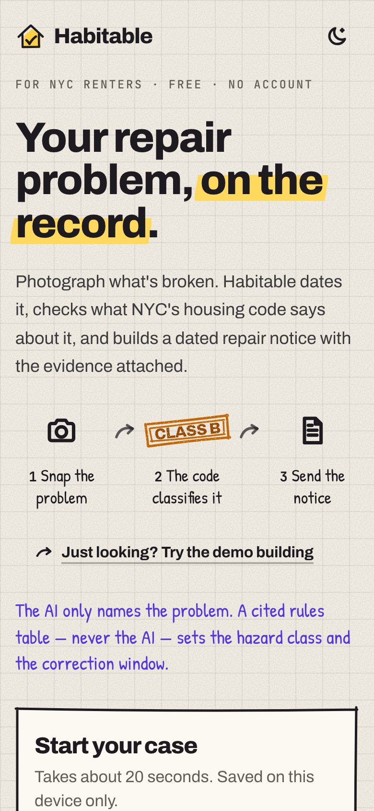
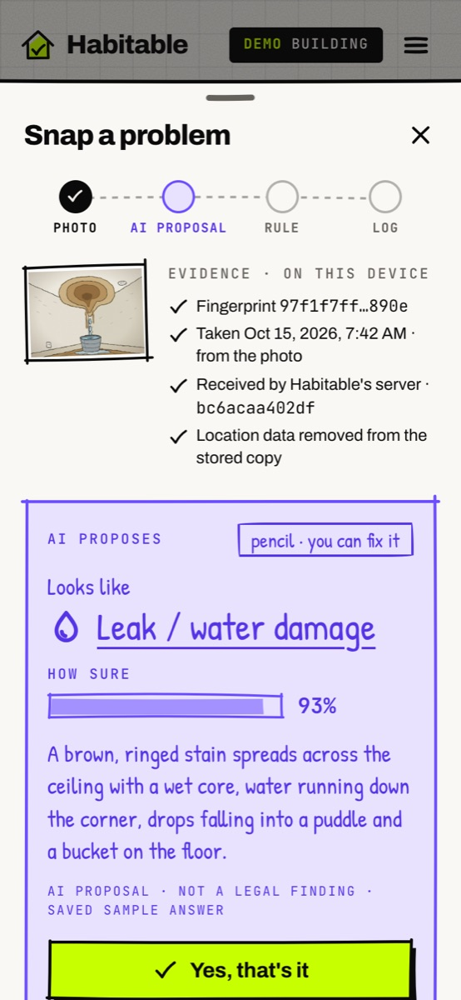
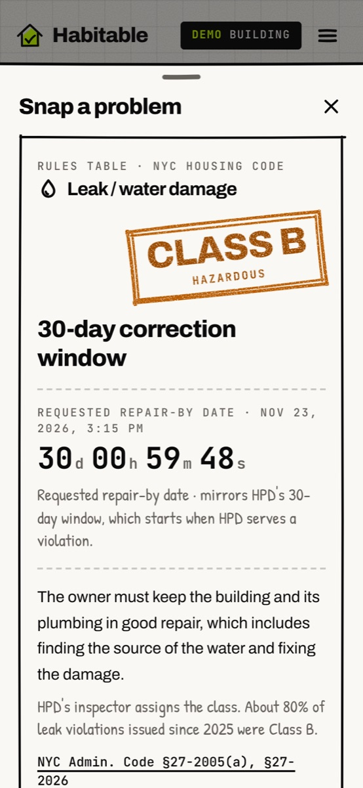
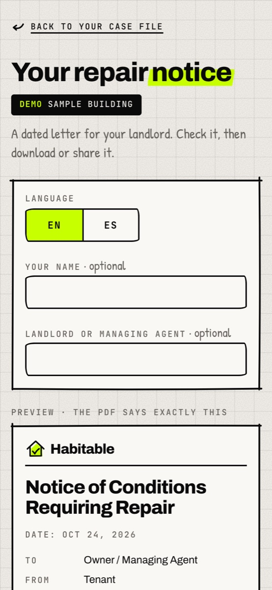
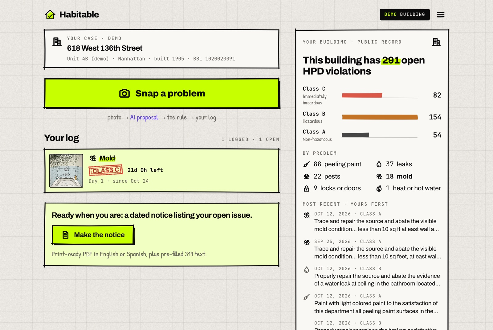
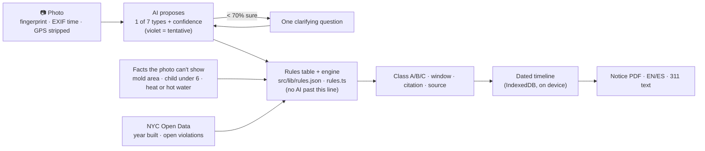

# Habitable

**Snap what's broken in your NYC apartment. Get a dated, housing-code-classified evidence log and a ready-to-send repair notice.**

**Live app:** https://habitable-blush.vercel.app · **Try it in 30 seconds:** open the link → *Try the demo building* → *Snap a problem* → pick the ceiling-leak sample.

Built for the Devpost **Build With AI: Basics** hackathon with the Devpost Learn skill pack. The planning documents are in [`devpost/`](devpost/).

| Welcome | AI proposes | Code disposes | Notice |
|---|---|---|---|
|  |  |  |  |



> **Not legal advice.** Habitable documents conditions and cites the rules HPD publishes. It doesn't represent you, and it never suggests withholding rent.

## What it does

1. **Set up once.** Type your NYC address (NYC GeoSearch suggests it) and unit. Habitable looks up the building's tax lot, year built and open HPD violations.
2. **Snap.** Take or choose a photo. On the phone, Habitable fingerprints the original (SHA-256), reads the capture time inside the photo (EXIF), strips location data, and gets a signed server receipt for the fingerprint.
3. **The AI proposes.** A vision model picks one of seven answers — leak, mold, no heat/hot water, pests, broken lock/door, peeling paint, or "not covered" — with a confidence and one sentence of why. Below 70% confidence, code asks you one clarifying question. You can always correct it.
4. **The code disposes.** A cited rules table — not the model — decides the hazard class and the correction window. If the rule needs a fact a photo can't show (mold area, a child under 6 in a pre-1960 building, heat vs. hot water), it asks you. The card shows the class stamp, the window, the code section, a live countdown to the requested repair-by date, and a "Why?" drawer with the exact rule, a short official quote and the source links.
5. **Building context.** "This building already has 291 open HPD violations — 37 for leaks." Plus who is registered with HPD as the managing agent and owner, problems reported to HPD in the last 12 months, litigation on record and whether the building is in HPD's Alternative Enforcement Program. Live from NYC Open Data for your address; the demo uses a saved snapshot.
6. **Log.** Every issue lands on a dated timeline with follow-ups ("still dripping, day 12") and "mark fixed".
7. **Notice.** Addressed to the registered managing agent (copying the owner) — prefilled from HPD's registration, editable. One tap makes a print-ready PDF (English or Spanish) listing every open issue with dates, photos, fingerprints, receipt links, citations and requested repair-by dates, plus pre-filled 311 complaint text.
8. **Heat and hot water log.** A photo can't show a temperature, so cold apartments get a dated log: indoor reading, outdoor temperature filled in from the National Weather Service (Central Park, falling back to LaGuardia or JFK when it's stale), and each reading stamped against NYC's minimums — 68°F by day when it's below 55°F outside, 62°F at night, hot water at least 120°F year-round — in plain cited code. Readings below the minimum go into the notice.
9. **What next.** A plain-language ladder — write to the landlord, file with 311 for an HPD inspection, an HP Action in Housing Court — plus free legal help, hotlines, DHCR rent reduction for rent-stabilized tenants, the warranty of habitability and protection from retaliation, every line linked to its official page. A card on the case file says which step fits right now.
10. **Keep it safe.** Back up the whole case (photos included) to a file and restore it on another phone; add any repair-by date to your calendar; the app opens with no signal once it has loaded. Light and dark themes.

## Who it's for

A New York City renter — often in an older, rent-stabilized building — with a leak, mold, no heat, pests, a broken lock or peeling paint, who usually complains by text, keeps no dated record, and doesn't know what the Housing Maintenance Code requires. Secondary: tenant organizers and legal-aid intake workers who need structured evidence.

**The scale, from the same NYC Open Data set the app reads** ([HPD Housing Maintenance Code Violations](https://data.cityofnewyork.us/Housing-Development/Housing-Maintenance-Code-Violations/wvxf-dwi5), queried 2026-10-25): about **2.65 million open violations** citywide — 587,952 Class C (immediately hazardous), 1,386,990 Class B and 676,016 Class A — and **85,096 buildings** with at least one open Class C violation. Every one of those started with someone documenting a condition.

## How it differs

- **JustFix** (Letter of Complaint, Who Owns What) sends a letter to the landlord and maps landlord portfolios. Habitable is about the evidence behind the letter: dated, fingerprinted photos, the class and correction window each condition falls under with its citation, and a receipt anyone can check.
- **The 311 app / portal** files a complaint and gets an inspection. Habitable's notice comes with pre-filled 311 text, so the two work together.
- **The camera roll** has the photos but no dates you can prove, no rule, no deadline and no document to send.

## AI proposes, code disposes



- The model can only answer from a fixed list, validated by a Zod schema, at temperature 0. It never sees, sets or mentions a class or a deadline.
- The confidence threshold, the clarifying question rule and every legal outcome are plain code with unit tests ([`src/lib/rules.test.ts`](src/lib/rules.test.ts) checks that every combination of facts reaches a cited outcome).
- Where HPD's inspector assigns the class in practice (leaks, locks, plaster), the card says so and shows how often HPD used each class since 2025.
- Honest clock: HPD correction windows run from HPD's *service of a violation*, not from your photo. The countdown is labelled as the repair-by date the notice requests, mirroring that window.

## The rules table

Verified 2026-10-24 against HPD's *Clear Violations* page, HPD's mold/pest, heat, lead-paint and self-closing-door pages, HPD's CY25 certification report, NYC311 articles and the enacted texts of Local Law 55 of 2018 and Local Law 86 of 2017. Full table with sources: [`devpost/spec.md` → Rules Table](devpost/spec.md#rules-table) and in the app at [`/how-it-works`](https://habitable-blush.vercel.app/how-it-works).

| Condition | What decides it | Class · window |
|---|---|---|
| Leak | actively dripping? | C · 24 h / B · 30 days |
| Mold (Local Law 55) | area in one room: < 10 / 10–29 / ≥ 30 sq ft | A · 90 d / B · 30 d / C · 21 d |
| Pests | mice, roaches, rats / bedbugs or other | C · 21 d / B · 30 d |
| Heat / hot water | hot water any time; heat Oct 1–May 31 | C · no time (notice asks 24 h) |
| Lock / door | can't lock / lock damaged / building entrance / not self-closing | C · 24 h / B · 30 d / C · 24 h / C · 14 d |
| Peeling paint | pre-1960 + child under 6 → presumed lead; plaster damage; paint only | C · 21 d / B · 30 d / A · 90 d |

## Evidence chain

- **Fingerprint:** SHA-256 of the original photo bytes, computed on the device.
- **Capture time:** read from the photo's EXIF; an offset tag fixes the zone, otherwise it is read as New York time (the app is NYC-only), so a viewer's timezone never shifts the evidence.
- **Server receipt:** `/api/receipt` returns `receivedAt` and an HMAC-SHA256 code over `sha256|receivedAt`. Anyone can check it at [`/verify`](https://habitable-blush.vercel.app/verify) — "Try a real receipt" signs a sample in one tap, "Change one character" shows a tampered one fail; every photo in the notice links to its own check. Production refuses to sign without `RECEIPT_SECRET`.
- **Privacy:** the stored copy is re-encoded on a canvas, which drops all metadata including GPS. The case lives only in the browser (IndexedDB). What leaves the device: a downscaled photo and your note to the AI, the fingerprint to the receipt service, and typed addresses to NYC GeoSearch.

## Reliability

- **Demo mode** answers sample photos from saved responses, so the demo never depends on an AI quota. Everything demo is labelled DEMO.
- **AI unavailable** (no key, quota, outage, timeout) → "Pick what it is — the rules still apply." The rest of the journey works.
- **Gemini free tier:** Gemini 3.5 Flash (thinking off, ~3 s) with 3.5 Flash-Lite as fallback, each with its own quota; no retries inside a model; a model that answers 429 rests for the delay the provider gives; identical requests are cached for an hour; 12 live photos per visitor per 10 minutes and 16 per minute per server instance; a 768 px image (one Gemini tile).
- **NYC Open Data down** → saved fixtures for the demo buildings; "Building records are unavailable right now" for others. Building lookups are cached for an hour.
- **Weather service stale or down** → the heat log asks for the outdoor temperature instead; the rule says what it needs.
- **No signal** → a service worker serves the pages and code this phone already loaded; the case itself lives in IndexedDB.

## Run it locally

Requirements: Node.js 20+ and npm.

```bash
npm install
```

```bash
npm run dev
```

Open http://localhost:3000 and choose **Try the demo building**. No keys are needed for the demo.

### Environment variables (`.env.local`, see [`.env.example`](.env.example))

| Variable | Needed for |
|---|---|
| `GOOGLE_GENERATIVE_AI_API_KEY` | Live AI on your own photos (Gemini). Without it — and without the next option — real photos use the manual picker. |
| `AI_GATEWAY_API_KEY` *(or `vercel env pull` for OIDC)* | Live AI through Vercel AI Gateway (Claude Haiku 5.5 → Gemini 3.5 Flash) instead of a Gemini key. |
| `RECEIPT_SECRET` | Signing evidence receipts. Required in production; any long random string. |
| `SOCRATA_APP_TOKEN` | Optional; raises NYC Open Data rate limits. |

## Tests

```bash
npm test
```

```bash
npm run test:e2e
```

- **Vitest — 276 tests:** rules engine (every fact combination reaches a cited outcome), heat and hot water minimums (hour edges, season edges, the 55°F outdoor line, DST days), countdown and DST, EXIF time zones, receipts (known-answer HMAC, tamper checks), classifier threshold/fallback/rate-limit cooldown/cache with a mock model, HPD violation text → issue mapping on real wordings, HPD registration parsing on real rows (multi-building lots, duplicates, addressee priority), weather-station fallback, backup validation, calendar files (escaping, folding, CRLF), GeoSearch parsing, notice text in English and Spanish, storage fallback.
- **Playwright — 44 phone tests, run on Chromium, WebKit (iPhone 14) and Firefox, plus 11 desktop smoke checks (135 runs: 133 pass, 2 skipped — the offline test is Chromium-only):** the full demo journey (photo → stamp → log → reload → follow-up → PDF download → Spanish), every rules branch, the heat log into the notice, landlord on record and the addressed notice, next steps links, backup → delete → restore, the calendar file, receipt verification (valid and tampered), theme toggle, the case menu, offline, error and empty states, API contracts, security headers. The suite builds and starts the production server itself and blanks all AI keys, so it never spends quota.

## How it was planned and built

Every step used the Devpost Learn skill pack (`.agents/skills/`, MIT):

| Step | Output |
|---|---|
| `1-start` | learner profile (kept out of git) |
| `2-scope` | [`devpost/scope.md`](devpost/scope.md) · [visual companion](devpost/scope.html) |
| `3-prd` | [`devpost/prd.md`](devpost/prd.md) · [visual companion](devpost/prd.html) |
| `4-spec` | [`devpost/spec.md`](devpost/spec.md) · [visual companion](devpost/spec.html) |
| `5-build` | [`devpost/checklist.md`](devpost/checklist.md) (slices, checkpoints, revisions) · [`devpost/app-map.html`](devpost/app-map.html) |

The commit history follows the plan: scope → PRD → spec → checklist → one commit per build slice. What the build discovered that changed the plan is recorded under **Revisions** in the checklist.

## Stack

Next.js 16 (App Router) · React 19 · TypeScript · Tailwind CSS 4 · AI SDK 7 (`@ai-sdk/google`, Vercel AI Gateway) · Zod 4 · exifr · idb-keyval · @react-pdf/renderer · Vitest · Playwright · Vercel. Visual identity: the "doodle" style (grid paper, hand-drawn ink) with a felt-tip palette — sunflower marker for actions and what the code decided, violet for everything the AI proposes, red / amber / sky for HPD Class C / B / A, mint for done — and a "night notebook" dark theme.

```
src/
├── app/            pages (/, /issue/[id], /notice, /heat, /next-steps, /how-it-works, /verify),
│                   API routes (classify, receipt, building, outdoor), PWA manifest, service worker
├── components/     doodle/ (hand-drawn UI kit), case/, snap/, issue/, heat/, notice/, site/
└── lib/            rules.json + rules.ts and heat.ts (the kernel), classify.ts, evidence.ts, receipt.ts,
                    building.ts, registration.ts, signals.ts, outdoor.ts, geosearch.ts, countdown.ts,
                    notice-text.ts, next-step.ts, backup.ts, ics.ts, store.ts, demo/
e2e/                Playwright suite
devpost/            planning documents
```

## Limits

- NYC only, six conditions. Classes for leaks, locks and plaster are assigned by HPD's inspector; the app shows the class matching HPD's published rules and examples.
- Whether a tenant's own letter starts any legal clock was not researched, so the app never claims it does.
- Receipts prove Habitable's server saw a fingerprint at a time; they are not a third-party timestamping service.
- The Spanish notice has not been reviewed by a native speaker.

## Credits and licenses

MIT — see [`LICENSE`](LICENSE). Third-party notices (Devpost Learn skill pack, fonts, data sources, npm packages): [`THIRD-PARTY-NOTICES.md`](THIRD-PARTY-NOTICES.md). Data: NYC Open Data (HPD Housing Maintenance Code Violations, Multiple Dwelling Registrations and Registration Contacts, Complaints and Problems, Litigations, Alternative Enforcement Program, PLUTO), NYC Planning Labs GeoSearch, the National Weather Service API, NYC HPD, NYC311, NYS HCR and NY Senate pages. Sample scenes are illustrations drawn for this project.
